<picture>
  <source media="(max-width: 600px) and (prefers-color-scheme: light)" srcset="./assets/hero-terminal-v2-mobile-light.svg" />
  <source media="(max-width: 600px)" srcset="./assets/hero-terminal-v2-mobile.svg" />
  <source media="(prefers-color-scheme: light)" srcset="./assets/hero-terminal-v2-light.svg" />
  
</picture>

<strong>English</strong> · <a href="./README.pt-BR.md">Português</a>

I’m **Marcus Boni**, a software engineer based in Espírito Santo, Brazil. I design and ship **end-to-end systems across native desktop, full-stack web, and applied AI** — from a 12-crate Rust & CUDA local transcription engine to Model Context Protocol servers, grounded `pgvector` retrieval pipelines, and custom WebGL interfaces.

**[Portfolio ↗](https://marcusboni.com.br/)** · **[LinkedIn ↗](https://www.linkedin.com/in/marcus-boni-729a52243/)** · **[Email ↗](mailto:mgalvaoboni@gmail.com)**

---

## Selected systems

### 01 · [ISPer](https://github.com/Marcus-Boni/ISPer) · Local-first voice engine & GPU

100% offline Windows voice dictation and Microsoft Teams meeting transcription built on a **12-crate Rust workspace** (`core`, `diarize`, `llm`, `agent`, `mcp`, `sync`, `cli`, `mobile` via `uniffi-bindgen`) with Tauri 2 and `whisper.cpp` (CPU/CUDA). Audio never leaves the machine; production crates enforce zero-`unwrap` Clippy policies and automated release validation across **25 releases (`v0.30.0`)**.

`Rust` `Tauri 2` `whisper.cpp` `CUDA` `UniFFI` `MCP` · [Site ↗](https://isper.pages.dev) · [Latest release ↗](https://github.com/Marcus-Boni/ISPer/releases/latest) · [12-crate workspace ↗](https://github.com/Marcus-Boni/ISPer/blob/72ea1174c881e860a32b3aed58f75edbdb5a2f86/Cargo.toml)

### 02 · [OptTime](https://github.com/Marcus-Boni/OptTime) · Developer workflow platform & MCP

Full-stack time-tracking platform wired bi-directionally into **Azure DevOps** work items, approval workflows, analytics dashboards, and Excel/PDF exports. Ships with an Azure DevOps extension, Microsoft Entra ID auth, and a dual-transport (`stdio` / HTTP) **Model Context Protocol server** (16 tools, 4 resources, 3 prompts) so AI agents operate under the exact same audited rules.

`TypeScript` `Next.js 16` `PostgreSQL` `Drizzle` `Better Auth` `MCP` · [Live ↗](https://opt-time.optsolv.com.br) · [MCP server ↗](https://github.com/Marcus-Boni/OptTime/blob/1e492d2e74dad1024c22c2230f0e07cc58796ceb/packages/opt-time-mcp/src/server.ts) · [MCP docs ↗](https://github.com/Marcus-Boni/OptTime/blob/1e492d2e74dad1024c22c2230f0e07cc58796ceb/docs/mcp-server.md)

### 03 · [chatbot-template](https://github.com/Marcus-Boni/chatbot-template) · Grounded RAG & retrieval evals

Config-driven RAG architecture for querying Microsoft Teams `.docx` meeting transcripts over `pgvector` on Neon Postgres. Every answer requires verifiable source citations (meeting, date, speaker) inside workspace-scoped boundaries, backed by a dedicated **retrieval evaluation harness** so precision is measured rather than guessed.

`TypeScript` `Next.js 16` `CopilotKit` `pgvector` `Drizzle` `Vitest` · [Retrieval eval ↗](https://github.com/Marcus-Boni/chatbot-template/blob/a9969fc6695030d20b109159a81ee40a0c4b5cc5/src/core/rag/eval.ts)

### 04 · [Portfolio](https://github.com/Marcus-Boni/Marcus-Boni-Portfolio) · Creative web engineering & OpenAPI

Bilingual editorial portfolio built with a custom **GLSL WebGL ink field**, procedural Canvas code-portrait assembly, a Markdown engineering journal, and first-party Firebase analytics. Exposes a public REST API, **OpenAPI contract test suite**, and machine-readable pages alongside the visual surface.

`React` `Vite` `TypeScript` `WebGL / GLSL` `Firebase` `OpenAPI` · [Live ↗](https://marcusboni.com.br/) · [GLSL shader ↗](https://github.com/Marcus-Boni/Marcus-Boni-Portfolio/blob/6d9e9b381e04c2a3689f5a1441089a8515d7b6ec/src/animations/glsl/inkField.ts) · [OpenAPI tests ↗](https://github.com/Marcus-Boni/Marcus-Boni-Portfolio/blob/6d9e9b381e04c2a3689f5a1441089a8515d7b6ec/tests/openapi.test.ts)

---

## Systems topology

<picture>
  <source media="(max-width: 600px) and (prefers-color-scheme: light)" srcset="./assets/systems-blueprint-v1-mobile-light.svg" />
  <source media="(max-width: 600px)" srcset="./assets/systems-blueprint-v1-mobile.svg" />
  <source media="(prefers-color-scheme: light)" srcset="./assets/systems-blueprint-v1-light.svg" />
  
</picture>

- **01 · Interfaces & Creative Web** — `TypeScript` `React` `Next.js` `WebGL / GLSL` `Tailwind CSS` `Flutter` `React Native`
- **02 · Applied AI & Agent Tooling** — `MCP Servers` `pgvector RAG` `Eval Harnesses` `whisper.cpp` `CopilotKit` `Ollama`
- **03 · Systems, Backend & Data** — `Rust` `Tauri 2` `UniFFI` `Node.js` `Python` `C#` `Java` `PostgreSQL` `Drizzle` `SQL Server`
- **04 · Cloud, Ops & Release** — `Azure` `Azure DevOps` `Docker` `GitHub Actions` `Firebase` `CPU / CUDA Pipelines`

<strong>More shipped tools &amp; experiments</strong>

- **[Auto Daily](https://github.com/Marcus-Boni/Auto-Daily-App)** — AI-assisted standup drafts synthesized from Azure DevOps commits and OptTime logs (`Next.js 16`, `React 19`, `TypeScript`) · [Live ↗](https://auto-daily-app.vercel.app)
- **[Hour Estimation](https://github.com/Marcus-Boni/Ferramenta-Estimativa-Horas)** — team-based estimation workflow replacing fragile Excel sheets, wired to Azure DevOps with dashboards and Excel export (`Next.js`, `Firebase`) · [Live ↗](https://ferramenta-estimativa-horas.vercel.app)
- **[Jarvis](https://github.com/Marcus-Boni/Jarvis)** — local-first developer assistant combining FastAPI, Ollama, vector memory, and a Next.js dashboard (`Python`, `FastAPI`, `Ollama`)
- **[SignalR Meetup](https://github.com/Marcus-Boni/SignalR-Meetup-App)** — real-time demo covering live tracking, multi-room chat, and asynchronous payment status (`C#`, `.NET SignalR`, `TypeScript`)

## How I engineer

- **Start with the real bottleneck.** Replace fragile spreadsheets and repetitive ops with focused software wired directly into the team’s ecosystem.
- **Draw explicit boundaries.** Isolate local compute, model inference, vector retrieval, and external APIs so privacy, latency, and failure modes stay predictable.
- **Verify behavior, don’t eyeball it.** Back RAG pipelines with retrieval evals, APIs with OpenAPI contract tests, Rust workspaces with strict Clippy lints, and releases with reproducible CI.
- **Treat craft as engineering.** From CUDA build paths and modular crate graphs to custom GLSL shaders and self-hosted SVGs — precision compounds into trust.

---

Building developer tools, local-first software, applied AI, or sharp web products? **[Let’s talk ↗](mailto:mgalvaoboni@gmail.com)** · [Portfolio](https://marcusboni.com.br/) · [LinkedIn](https://www.linkedin.com/in/marcus-boni-729a52243/)
