<picture>
  <source media="(max-width: 600px) and (prefers-color-scheme: light)" srcset="./assets/hero-terminal-v3-mobile-light.svg" />
  <source media="(max-width: 600px)" srcset="./assets/hero-terminal-v3-mobile.svg" />
  <source media="(prefers-color-scheme: light)" srcset="./assets/hero-terminal-v3-light.svg" />
  
</picture>

<a href="./README.md">English</a> · <strong>Português</strong>

Sou **Marcus Boni**, engenheiro de software no Espírito Santo, Brasil. Construo **produtos full-stack, sistemas desktop nativos e fluxos de IA aplicada** — unindo fundamentos sólidos de engenharia ao desenvolvimento assistido por IA e publicando notas técnicas no [meu blog](https://marcusboni.com.br/blog).

[Portfólio ↗](https://marcusboni.com.br/) · [Blog ↗](https://marcusboni.com.br/blog) · [LinkedIn ↗](https://www.linkedin.com/in/marcus-boni-729a52243/) · [E-mail ↗](mailto:mgalvaoboni@gmail.com)

---

## Projetos em destaque

### 01 · [ISPer](https://github.com/Marcus-Boni/ISPer) · Motor de voz local-first

Ditado offline no Windows e transcrição de reuniões do Teams construídos em um **workspace Rust de 12 crates**, Tauri 2 e `whisper.cpp` (CPU/CUDA). O áudio permanece na máquina; crates de produção aplicam regras estritas sem `unwrap` no Clippy ao longo de **25 releases (`v0.30.0`)**.

`Rust` `Tauri 2` `whisper.cpp` `CUDA` `MCP` · [Site ↗](https://isper.pages.dev) · [Releases ↗](https://github.com/Marcus-Boni/ISPer/releases/latest) · [Workspace ↗](https://github.com/Marcus-Boni/ISPer/blob/72ea1174c881e860a32b3aed58f75edbdb5a2f86/Cargo.toml)

### 02 · [OptTime](https://github.com/Marcus-Boni/OptTime) · Fluxos de engenharia & MCP

Apontamento de horas full-stack sincronizado bidirecionalmente com o **Azure DevOps**, incluindo fluxos de aprovação, dashboards, autenticação Entra ID e extensão nativa. Entrega também um **servidor MCP** de transporte duplo (`stdio`/HTTP — 16 ferramentas, 4 recursos, 3 prompts) para agentes de IA.

`TypeScript` `Next.js 16` `PostgreSQL` `Drizzle` `MCP` · [Aplicação ↗](https://opt-time.optsolv.com.br) · [Servidor MCP ↗](https://github.com/Marcus-Boni/OptTime/blob/1e492d2e74dad1024c22c2230f0e07cc58796ceb/packages/opt-time-mcp/src/server.ts)

### 03 · [chatbot-template](https://github.com/Marcus-Boni/chatbot-template) · RAG com fontes & avaliação

Template RAG orientado por configuração para consultar transcrições do Microsoft Teams com `pgvector` no Neon Postgres. Exige citações verificáveis das fontes, isolamento por workspace e uma **suíte de avaliação de busca** para medir qualidade com evidência.

`TypeScript` `Next.js 16` `CopilotKit` `pgvector` `Vitest` · [Avaliação da busca ↗](https://github.com/Marcus-Boni/chatbot-template/blob/a9969fc6695030d20b109159a81ee40a0c4b5cc5/src/core/rag/eval.ts)

### 04 · [Portfólio & Blog](https://github.com/Marcus-Boni/Marcus-Boni-Portfolio) · Engenharia web & OpenAPI

Portfólio bilíngue e caderno técnico com **campo de tinta em WebGL/GLSL**, retrato procedural em código, publicação em Markdown e analytics próprios. Expõe uma API REST pública com **testes de contrato OpenAPI** e páginas legíveis por agentes.

`React` `TypeScript` `WebGL` `Firebase` `OpenAPI` · [Site ↗](https://marcusboni.com.br/) · [Blog ↗](https://marcusboni.com.br/blog) · [Testes OpenAPI ↗](https://github.com/Marcus-Boni/Marcus-Boni-Portfolio/blob/6d9e9b381e04c2a3689f5a1441089a8515d7b6ec/tests/openapi.test.ts)

---

## Arquitetura e stack

<picture>
  <source media="(max-width: 600px) and (prefers-color-scheme: light)" srcset="./assets/systems-blueprint-v2-mobile-light.svg" />
  <source media="(max-width: 600px)" srcset="./assets/systems-blueprint-v2-mobile.svg" />
  <source media="(prefers-color-scheme: light)" srcset="./assets/systems-blueprint-v2-light.svg" />
  
</picture>

- **Interfaces** — TypeScript, React, Next.js, WebGL/GLSL, Tailwind CSS, Flutter, React Native
- **IA Aplicada** — Servidores MCP, RAG com pgvector, Avaliação de Busca, whisper.cpp, CopilotKit, Ollama
- **Sistemas & Dados** — Rust, Tauri 2, UniFFI, Node.js, Python, C#/.NET, Java/Spring, PostgreSQL, Drizzle
- **Nuvem & Entrega** — Azure, Azure DevOps, Docker, GitHub Actions, Firebase, Releases CPU/CUDA

## Escrita técnica

Publico com frequência artigos sobre engenharia de software, arquitetura, IA aplicada e bastidores técnicos de projetos reais em **[marcusboni.com.br/blog ↗](https://marcusboni.com.br/blog)**.

<strong>Mais projetos</strong>

- **[Auto Daily](https://github.com/Marcus-Boni/Auto-Daily-App)** — rascunhos de daily com IA gerados a partir de commits no Azure DevOps e apontamentos do OptTime · [Aplicação ↗](https://auto-daily-app.vercel.app)
- **[Estimativa de Horas](https://github.com/Marcus-Boni/Ferramenta-Estimativa-Horas)** — fluxo web por equipe integrado ao Azure DevOps com dashboards e exportação em Excel · [Aplicação ↗](https://ferramenta-estimativa-horas.vercel.app)
- **[Jarvis](https://github.com/Marcus-Boni/Jarvis)** — assistente local-first para desenvolvedores com FastAPI, Ollama, memória vetorial e dashboard em Next.js
- **[SignalR Meetup](https://github.com/Marcus-Boni/SignalR-Meetup-App)** — demonstração em tempo real com .NET SignalR, tracking ao vivo, chat em salas e status assíncrono de pagamento

## Como construo

- **Engenharia assistida por IA com base em fundamentos.** Utilizo IA de forma deliberada para explorar arquiteturas, aprofundar entendimento técnico e acelerar entregas — sempre guiado por boas práticas de mercado, revisão crítica e clareza de código.
- **Começar pelo fluxo real.** Transformar atritos operacionais repetitivos em ferramentas focadas e integradas diretamente ao ecossistema do time.
- **Limites explícitos e comportamento verificável.** Isolar processamento local, inferência e acesso a dados; validar com avaliações de busca, testes de contrato OpenAPI, lints estritos e CI reproduzível.
- **Evolução contínua em público.** Acompanhar de perto o avanço em sistemas, IA aplicada e engenharia web — documentando decisões técnicas e aprendizados reais no [blog](https://marcusboni.com.br/blog).

---

Interesse em ferramentas para desenvolvedores, IA aplicada ou engenharia de software bem feita? **[Vamos conversar ↗](mailto:mgalvaoboni@gmail.com)** · [Portfólio](https://marcusboni.com.br/) · [Blog](https://marcusboni.com.br/blog) · [LinkedIn](https://www.linkedin.com/in/marcus-boni-729a52243/)
