<picture>
  <source media="(max-width: 600px) and (prefers-color-scheme: light)" srcset="./assets/hero-terminal-v2-mobile-light.svg" />
  <source media="(max-width: 600px)" srcset="./assets/hero-terminal-v2-mobile.svg" />
  <source media="(prefers-color-scheme: light)" srcset="./assets/hero-terminal-v2-light.svg" />
  
</picture>

<a href="./README.md">English</a> · <strong>Português</strong>

Sou **Marcus Boni**, engenheiro de software no Espírito Santo, Brasil. Projeto e entrego **sistemas ponta a ponta entre desktop nativo, web full-stack e IA aplicada** — de um motor local de transcrição em Rust com 12 crates e CUDA a servidores Model Context Protocol, pipelines RAG com `pgvector` e interfaces autorais em WebGL.

**[Portfólio ↗](https://marcusboni.com.br/)** · **[LinkedIn ↗](https://www.linkedin.com/in/marcus-boni-729a52243/)** · **[E-mail ↗](mailto:mgalvaoboni@gmail.com)**

---

## Sistemas em destaque

### 01 · [ISPer](https://github.com/Marcus-Boni/ISPer) · Motor de voz local-first & GPU

Ditado por voz no Windows e transcrição de reuniões do Microsoft Teams 100% offline, estruturados em um **workspace Rust de 12 crates** (`core`, `diarize`, `llm`, `agent`, `mcp`, `sync`, `cli`, `mobile` via `uniffi-bindgen`) com Tauri 2 e `whisper.cpp` (CPU/CUDA). O áudio nunca sai da máquina; crates de produção aplicam lints estritos sem `unwrap` no Clippy e validações automatizadas ao longo de **25 releases (`v0.30.0`)**.

`Rust` `Tauri 2` `whisper.cpp` `CUDA` `UniFFI` `MCP` · [Site ↗](https://isper.pages.dev) · [Última release ↗](https://github.com/Marcus-Boni/ISPer/releases/latest) · [Workspace de 12 crates ↗](https://github.com/Marcus-Boni/ISPer/blob/72ea1174c881e860a32b3aed58f75edbdb5a2f86/Cargo.toml)

### 02 · [OptTime](https://github.com/Marcus-Boni/OptTime) · Fluxos de engenharia & servidor MCP

Plataforma full-stack de apontamento de horas integrada bidirecionalmente ao **Azure DevOps**, com fluxos de aprovação, dashboards analíticos e exportação em Excel/PDF. Inclui extensão para Azure DevOps, autenticação Microsoft Entra ID e um **servidor Model Context Protocol** com transporte duplo (`stdio` / HTTP — 16 ferramentas, 4 recursos e 3 prompts) para agentes de IA operarem sob as mesmas regras auditadas.

`TypeScript` `Next.js 16` `PostgreSQL` `Drizzle` `Better Auth` `MCP` · [Aplicação ↗](https://opt-time.optsolv.com.br) · [Servidor MCP ↗](https://github.com/Marcus-Boni/OptTime/blob/1e492d2e74dad1024c22c2230f0e07cc58796ceb/packages/opt-time-mcp/src/server.ts) · [Documentação MCP ↗](https://github.com/Marcus-Boni/OptTime/blob/1e492d2e74dad1024c22c2230f0e07cc58796ceb/docs/mcp-server.md)

### 03 · [chatbot-template](https://github.com/Marcus-Boni/chatbot-template) · RAG com fontes & avaliação

Arquitetura RAG orientada por configuração para consultar transcrições `.docx` de reuniões do Microsoft Teams com `pgvector` no Neon Postgres. Toda resposta exige citações rastreáveis (reunião, data e participante) com isolamento por workspace, apoiada por uma **suíte dedicada de avaliação de recuperação** para medir precisão com dados em vez de tentativa e erro.

`TypeScript` `Next.js 16` `CopilotKit` `pgvector` `Drizzle` `Vitest` · [Avaliação da busca ↗](https://github.com/Marcus-Boni/chatbot-template/blob/a9969fc6695030d20b109159a81ee40a0c4b5cc5/src/core/rag/eval.ts)

### 04 · [Portfólio](https://github.com/Marcus-Boni/Marcus-Boni-Portfolio) · Engenharia web criativa & OpenAPI

Portfólio editorial bilíngue com **campo de tinta interativo em WebGL/GLSL**, retrato procedural montado em código no Canvas, blog técnico em Markdown e analytics próprios no Firebase. Expõe uma API REST pública, **testes de contrato OpenAPI** e páginas legíveis por agentes além da interface visual.

`React` `Vite` `TypeScript` `WebGL / GLSL` `Firebase` `OpenAPI` · [Site ↗](https://marcusboni.com.br/) · [Shader GLSL ↗](https://github.com/Marcus-Boni/Marcus-Boni-Portfolio/blob/6d9e9b381e04c2a3689f5a1441089a8515d7b6ec/src/animations/glsl/inkField.ts) · [Testes OpenAPI ↗](https://github.com/Marcus-Boni/Marcus-Boni-Portfolio/blob/6d9e9b381e04c2a3689f5a1441089a8515d7b6ec/tests/openapi.test.ts)

---

## Arquitetura e stack

<picture>
  <source media="(max-width: 600px) and (prefers-color-scheme: light)" srcset="./assets/systems-blueprint-v1-mobile-light.svg" />
  <source media="(max-width: 600px)" srcset="./assets/systems-blueprint-v1-mobile.svg" />
  <source media="(prefers-color-scheme: light)" srcset="./assets/systems-blueprint-v1-light.svg" />
  
</picture>

- **01 · Interfaces & Web Criativa** — `TypeScript` `React` `Next.js` `WebGL / GLSL` `Tailwind CSS` `Flutter` `React Native`
- **02 · IA Aplicada & Ferramentas para Agentes** — `Servidores MCP` `RAG com pgvector` `Avaliação de Busca` `whisper.cpp` `CopilotKit` `Ollama`
- **03 · Sistemas, Backend & Dados** — `Rust` `Tauri 2` `UniFFI` `Node.js` `Python` `C#` `Java` `PostgreSQL` `Drizzle` `SQL Server`
- **04 · Nuvem, Ops & Release** — `Azure` `Azure DevOps` `Docker` `GitHub Actions` `Firebase` `Pipelines CPU / CUDA`

<strong>Mais ferramentas e experimentos</strong>

- **[Auto Daily](https://github.com/Marcus-Boni/Auto-Daily-App)** — rascunhos de daily com IA sintetizados a partir de commits no Azure DevOps e apontamentos no OptTime (`Next.js 16`, `React 19`, `TypeScript`) · [Aplicação ↗](https://auto-daily-app.vercel.app)
- **[Estimativa de Horas](https://github.com/Marcus-Boni/Ferramenta-Estimativa-Horas)** — fluxo web por equipe que substitui planilhas frágeis de Excel, integrado ao Azure DevOps com dashboards e exportação (`Next.js`, `Firebase`) · [Aplicação ↗](https://ferramenta-estimativa-horas.vercel.app)
- **[Jarvis](https://github.com/Marcus-Boni/Jarvis)** — assistente local-first para desenvolvedores combinando FastAPI, Ollama, memória vetorial e dashboard em Next.js (`Python`, `FastAPI`, `Ollama`)
- **[SignalR Meetup](https://github.com/Marcus-Boni/SignalR-Meetup-App)** — demonstração em tempo real com tracking ao vivo, chat em múltiplas salas e status assíncrono de pagamentos (`C#`, `.NET SignalR`, `TypeScript`)

## Como construo

- **Começar pelo gargalo real.** Substituir planilhas frágeis e etapas operacionais repetitivas por software focado, integrado diretamente às ferramentas do time.
- **Explicitar os limites do sistema.** Separar processamento local, inferência de modelos, camada de busca e APIs externas para manter privacidade, latência e falhas previsíveis.
- **Validar comportamento com evidência.** Apoiar pipelines RAG com avaliações de busca, APIs com testes de contrato OpenAPI, workspaces Rust com lints rigorosos no Clippy e releases com CI reproduzível.
- **Tratar acabamento como engenharia.** De pipelines de build CUDA e grafos de crates modulares a shaders GLSL autorais e SVGs auto-hospedados — precisão gera confiança.

---

Construindo ferramentas para desenvolvedores, software local-first, IA aplicada ou produtos web bem executados? **[Vamos conversar ↗](mailto:mgalvaoboni@gmail.com)** · [Portfólio](https://marcusboni.com.br/) · [LinkedIn](https://www.linkedin.com/in/marcus-boni-729a52243/)
